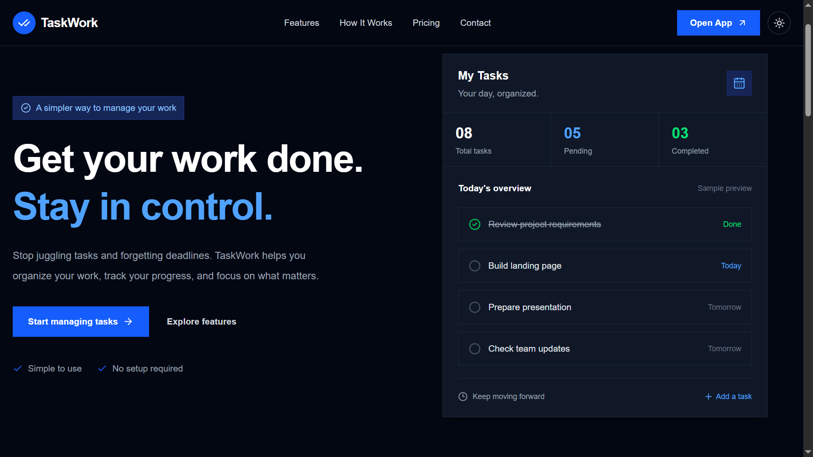
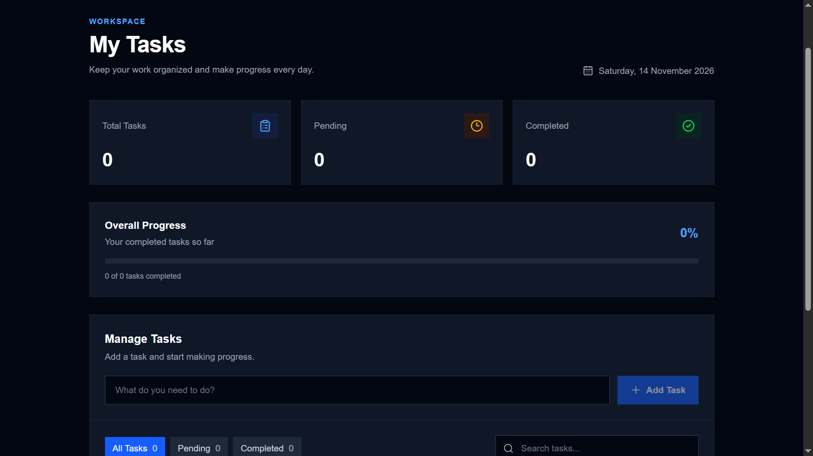

# TaskWork

## Project Overview

TaskWork is a simple task management application designed to help users organize their daily tasks and keep track of their progress. It provides an easy-to-use interface for managing tasks, monitoring completion status, and maintaining productivity.

## Live Demo

[View Live Demo](https://taskwork-phi.vercel.app)

## Preview

### Home Page



### Dashboard



## Features

- Add, complete, and delete tasks
- Search and filter tasks
- Track task progress
- View task statistics
- Light and dark themes
- Responsive design
- Save tasks using local storage

## Tech Stack

- React
- Vite
- Tailwind CSS
- React Router DOM
- Lucide React

## Getting Started

Clone the repository:

```bash
git clone https://github.com/ankitanuragi1/TaskWork.git
```

Install dependencies:

```bash
npm install
```

Start the development server:

```bash
npm run dev
```

## Build

```bash
npm run build
```

## License

This project is open-source and available under the MIT License.
